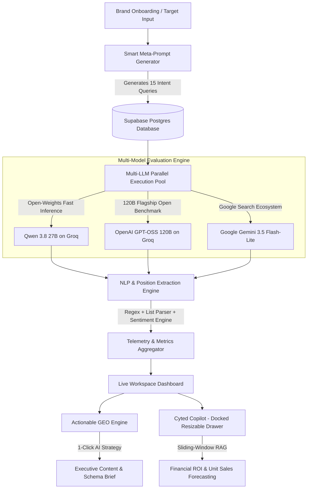

# Cyted ⚡ — Generative Engine Optimization (GEO) Platform
### *AI Search Analytics, Share of Voice & Visibility Intelligence for the Generative Era*

[](https://nextjs.org/)
[](https://www.typescriptlang.org/)
[](https://supabase.com/)
[](https://groq.com/)
[](https://ai.google.dev/)
[](https://www.prisma.io/)

---

## 🌟 The Origin & Inspiration

The foundation of **Cyted** was sparked during my college journey. I observed my senior from 5th semester interning at **Scaler AI (Evaratus)**, who was immersed in the cutting-edge frontier of Generative AI search systems. 

Through our conversations, a fundamental truth became crystal clear: **The era of traditional Google SEO is nearing obsolescence.** 

Consumers no longer sift through 10 sponsored blue links on Google. Today, high-intent buyers prompt ChatGPT, Google Gemini, and Perplexity with specific queries:  
> *"What are the most durable running shoes for 2025?"*  
> *"Should I buy Hoka or Nike for marathon training?"*

If your brand is not explicitly recommended, ranked in the top 3, or cited with positive sentiment by these foundation models, **your business effectively does not exist in the generative economy.** 

Inspired by this paradigm shift, I built **Cyted** — a dedicated **Generative Engine Optimization (GEO)** platform that measures, diagnoses, and optimizes brand visibility across leading LLMs.

---

## 🚀 What is Cyted?

**Cyted** is an enterprise-grade AI Search Visibility & Brand Intelligence platform. It functions like *SEMrush or Ahrefs, but specifically engineered for Generative AI engines*. 

Instead of tracking keywords and backlinks, Cyted tracks:
1. **AI Recommendation Rankings**: Where foundation models position your brand when consumers ask category-buying questions.
2. **Generative Share of Voice (SOV)**: The percentage of AI-generated answers that cite your brand versus competitors (Nike, On Running, Asics, etc.).
3. **Sentiment Extraction**: Distinguishing between passive neutral mentions and enthusiastic, conversion-driving endorsements.
4. **Actionable Content Opportunities**: Reverse-engineering the exact data gaps, comparison matrices, and schema markups needed to flip #4 rankings into undisputed #1 recommendations.
5. **Docked AI Search Strategist (Copilot)**: An in-app executive chatbot with live access to dashboard telemetry, financial ROI modeling, and competitor intelligence.

---

## 🏗️ System Architecture



---

## ⚡ Core Platform Features

### 1. Multi-LLM Benchmarking Matrix
Cyted runs real-time queries across **3 foundational model classes** simultaneously:
* **`qwen/qwen3.8-27b` (via Groq LPU)**: Represents agile, open-weights models and AI search agents.
* **`openai/gpt-oss-120b` (via Groq LPU)**: Represents 120-Billion parameter flagship models (ChatGPT class).
* **`gemini-3.5-flash-lite` (via Google AI API)**: Represents Google’s search-augmented AI ecosystem.

> **Scale:** For a brand tracking 15 high-intent buyer queries, every audit run executes **45 live generative search evaluations** ($15 \times 3$), parsing mentions, rankings, and sentiments in parallel.

### 2. The GEO Scorecard (Core Analytics)
* **AI Visibility Rate (%)**: The percentage of target buyer prompts where your brand was actively recognized and cited by tested LLMs.
* **Share of Voice (SOV) (%)**: Normalized share of total brand recommendations vs. competitors across all tested models.
* **Average Recommended Rank (#)**: Average list position when your brand is recommended (e.g. `#1.7` vs Nike's `#1.5`).
* **Positive Sentiment Rate (%)**: Percentage of citations that enthusiastically endorse the brand rather than offering passive/neutral mentions.

### 3. Actionable GEO Opportunity Engine
Generates commercial growth vectors based on live query data:
* **Rank Conquest**: Targets queries where competitors hold position #1, providing step-by-step tactics to flip the ranking.
* **Defend Monopoly**: Identifies queries where you own the #1 position and gives guidance to prevent competitors from unseating you.
* **1-Click Executive GEO Brief**: Automatically synthesizes 5-part technical briefs including H1/H2 structures, 500-mile wear test lab outlines, comparison matrices, and JSON-LD structured schema.

### 4. Cyted Copilot (Docked AI Search Strategist)
* **Interactive Drag-to-Slide Panel**: Features a 24px grab handle on the left edge with 60 FPS zero-lag resizing, touch support, and header preset buttons (`460px`, `680px`, `Wide`).
* **Dynamic Page Reflow**: The dashboard seamlessly pushes and reflows alongside the open drawer.
* **Sliding-Window Token Manager**: Solves Groq/LLM free-tier TPM limits by keeping a compact active context window with auto-truncation and single-turn recovery.
* **Financial Modeling Engine**: Models revenue upside, CTR lifts, AOV, and unit sales conversions (e.g., calculating the exact unit sales impact of capturing 10% SOV from Nike).

### 5. Multi-Tenant Isolated Database Architecture
* Built on **Supabase PostgreSQL** isolated inside a dedicated `cyted` schema to ensure zero collision with other projects.
* Complete relational schema covering `User`, `Brand`, `Competitor`, `Prompt`, `Run`, `PromptResult`, and `BrandMention`.

---

## 💻 Tech Stack & Engineering Specifications

| Layer | Technologies Used | Key Responsibilities |
| :--- | :--- | :--- |
| **Frontend** | **Next.js 16 (App Router)**, React 19, TypeScript | Server & Client Components, Responsive Glassmorphism UI, Vanilla CSS design tokens. |
| **Icons & Visuals** | **Lucide React**, Custom SVG chart engines | Sleek micro-interactions, metrics gauges, animated progress indicators. |
| **Inference Engines** | **Groq LPU API**, **Google Generative AI** | Ultra-low latency LLM generation (`qwen/qwen3.8-27b`, `openai/gpt-oss-120b`, `gemini-3.5-flash-lite`). |
| **Backend & APIs** | Next.js Route Handlers (`/api/*`) | Asynchronous audit runner, LLM streaming, token sanitizer, prompt synthesizers. |
| **Database & ORM** | **Supabase (PostgreSQL)**, **Prisma ORM 5** | Schema migrations, PgBouncer transaction pooling, indexed relational queries. |
| **Authentication** | **Supabase Auth** | Secure session management, JWT verification, protected route middleware. |

---

## 📊 Mathematical Logic & Formulations

### 1. Share of Voice (SOV)
$$\text{SOV}_{\text{Brand}} = \left( \frac{\sum \text{Mentions}_{\text{Brand}}}{\sum \text{Mentions}_{\text{All Brands in Category}}} \right) \times 100$$

### 2. Generative Search Revenue Impact
$$\Delta \text{Units/Month} = \left( \text{Market Monthly AI Query Volume} \times \Delta\text{SOV} \right) \times \text{CTR}_{\text{Rank}} \times \text{CR}_{\text{Sentiment}}$$

* *Example:* Diverting 10% of Nike’s 15.7% SOV ($+1.57\%$ market share) in a category of 100,000 monthly AI queries yields **10,000 new high-intent buyer exposures**. At a 2% conversion rate, this drives **~200 extra pairs/month**; elevating sentiment to 80%+ pushes conversion to 5% (**~500 extra pairs/month**).

---

## 🛠️ Getting Started Locally

### Prerequisites
* Node.js 18.x or 20.x
* npm / pnpm / yarn
* A Supabase project (PostgreSQL)
* Free API keys from [Groq Console](https://console.groq.com) and [Google AI Studio](https://aistudio.google.com)

### 1. Clone the Repository
```bash
git clone https://github.com/YOUR_USERNAME/Cyted.git
cd Cyted
```

### 2. Install Dependencies
```bash
npm install
```

### 3. Configure Environment Variables
Copy `.env.example` to `.env`:
```bash
cp .env.example .env
```
Fill in your credentials:
```env
# Supabase Credentials
NEXT_PUBLIC_SUPABASE_URL="https://your-project.supabase.co"
NEXT_PUBLIC_SUPABASE_ANON_KEY="your-anon-key"
SUPABASE_JWT_SECRET="your-jwt-secret"

# PostgreSQL Connection Strings
DATABASE_URL="postgresql://postgres:[PASSWORD]@[HOST]:6543/postgres?schema=cyted&pgbouncer=true"
DIRECT_URL="postgresql://postgres:[PASSWORD]@[HOST]:5432/postgres?schema=cyted"

# AI Inference Keys
GROQ_API_KEY="gsk_..."
GEMINI_API_KEY="AIzaSy..."
```

### 4. Push Database Schema
```bash
npx prisma db push
```

### 5. Launch the Development Server
```bash
npm run dev
```
Open **[http://localhost:3000](http://localhost:3000)** in your browser.

---

## 📂 Project Directory Structure

```plaintext
Cyted/
├── prisma/
│   └── schema.prisma             # Relational data schema (isolated in cyted namespace)
├── src/
│   ├── app/
│   │   ├── api/
│   │   │   ├── analytics/        # Aggregate telemetry (SOV, ranks, sentiments)
│   │   │   ├── auth/sync/        # Supabase auth session sync
│   │   │   ├── brands/           # Brand onboarding & CRUD
│   │   │   ├── brief/            # 1-Click AI GEO content brief generator
│   │   │   ├── copilot/          # Cyted Copilot RAG & token-managed chat handler
│   │   │   ├── prompts/          # Smart 15-query prompt generator
│   │   │   └── runs/             # Multi-LLM audit execution pipeline
│   │   ├── login/                # Authentication page
│   │   ├── signup/               # Registration page
│   │   ├── layout.tsx            # Global app layout
│   │   └── page.tsx              # Main Workspace Dashboard & reflow container
│   ├── components/
│   │   ├── ContentOpportunities.tsx # High-ROI Rank Conquest & Defense cards
│   │   ├── GeoCopilotDrawer.tsx     # Resizable, draggable, 60 FPS Copilot panel
│   │   ├── MetricCard.tsx           # Glassmorphism live telemetry metric tiles
│   │   ├── ModelComparison.tsx      # Multi-model ranking matrix breakdown
│   │   ├── Navbar.tsx               # Brand switcher & status header
│   │   ├── OnboardingModal.tsx      # Add Brand & competitor configuration
│   │   ├── PromptsExplorer.tsx      # 15-Prompt breakdown with LLM responses
│   │   └── ShareOfVoiceChart.tsx    # Multi-brand visual SOV benchmark bars
│   ├── lib/
│   │   ├── db.ts                    # Prisma client singleton
│   │   ├── llm.ts                   # Multi-LLM caller (Groq Qwen, GPT-OSS, Gemini)
│   │   └── supabase.ts              # Supabase browser & server clients
│   └── services/
│       ├── analyzerService.ts       # Regex & NLP position/sentiment parser
│       ├── promptService.ts         # Query generation & categorizer
│       └── runService.ts            # Parallel audit runner with timeout isolation
├── .env.example                  # Sanitized template for environment variables
├── .gitignore                    # Comprehensive ignore rules (secrets protected)
├── package.json
└── README.md
```

---

## 💡 Future Roadmap
- [ ] **Automated Headless Crawling**: Scheduled recurring crons to track rank volatility week-over-week.
- [ ] **Perplexity Live Citations**: Extracting external URL sources cited directly in Perplexity answers.
- [ ] **One-Click CMS Publishing**: Auto-publishing optimized comparison pages directly to WordPress, Webflow, or Shopify.
- [ ] **Slack & Discord Alerts**: Automated notification whenever a competitor displaces your brand from the #1 spot.

---

## 👤 Author & Acknowledgements
* **Vipul Jain** — Architect & Developer
* *Special thanks to my college senior interning at **Scaler AI (Evaratus)** for planting the seed of Generative Engine Optimization (GEO) and inspiring this build.*

---
⭐ *If you find this project insightful, consider starring the repository!*
